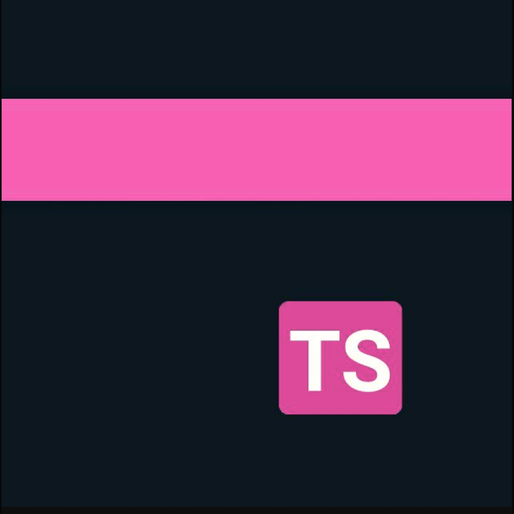

# [nostream](https://github.com/cameri/nostream)

<p align="center">
  
</p>

<p align="center">
  <a href="https://github.com/cameri/nostream/releases">
    
  </a>
  <a href="https://github.com/cameri/nostream/issues">
    
  </a>
  <a href="https://github.com/cameri/nostream/stargazers">
    
  </a>
  
  <a href="https://github.com/cameri/nostream/network">
    
  </a>
  <a href="https://github.com/cameri/nostream/blob/main/LICENSE">
    
  </a>
  <a href='https://coveralls.io/github/cameri/nostream?branch=main'>
    
  </a>
  <a href='https://github.com/cameri/nostream/actions'>
    
  </a>
  <a href="https://www.greptile.com/?utm_source=oss_badge&utm_medium=readme&utm_campaign=greptile_for_open_source">
    
  </a>
</p>

This is a [nostr](https://github.com/fiatjaf/nostr) relay, written in
TypeScript. Documentation, features and guides live on the project website:
**[nostream.dev](https://nostream.dev)**.

This implementation is production-ready. See below for supported features.

The project master repository is available on [GitHub](https://github.com/cameri/nostream).

[](https://railway.app/new/template/Xfk5F7?referralCode=Kfv2ly)

## Documentation

Start with the guide for what you want to do; the README stays short on purpose.

| Guide | Covers |
| --- | --- |
| [Production setup](docs/SETUP.md) | Host preparation, Docker Compose, TLS reverse proxy, verification |
| [Deployment runbook](docs/DEPLOY-RUNBOOK.md) | Releasing images, zero-downtime updates, health checks |
| [Configuration](CONFIGURATION.md) | Every environment variable and setting |
| [CLI](CLI.md) | `nostream` commands, exit codes, config commands, development helpers |
| [Payments](docs/PAYMENTS.md) | Charging an admission fee with ZEBEDEE, Nodeless, OpenNode, LNbits, LNURL or NWC |
| [Operations](docs/OPERATIONS.md) | Backups, maintenance, query benchmarking, systemd, troubleshooting |
| [Peering](docs/PEERING.md) | Configuring peers, authenticating, syncing their events |
| [Redis](docs/REDIS.md) | Why the relay needs Redis, and how to configure it |
| [Contributing](CONTRIBUTING.md) | Development setup, tests, load and performance testing |
| [Security policy](SECURITY.md) | Reporting a vulnerability |
| [Changelog](CHANGELOG.md) | Released changes |

## Features

NIPs and MIPs with a relay-specific implementation are listed here.

- [x] NIP-01: Basic protocol flow description
- [x] NIP-02: Contact list and petnames
- [x] NIP-03: OpenTimestamps Attestations for Events
- [x] NIP-04: Encrypted Direct Message
- [x] NIP-05: Mapping Nostr keys to DNS-based internet identifiers
- [x] NIP-09: Event deletion
- [x] NIP-11: Relay information document
- [x] NIP-12: Generic tag queries
- [x] NIP-13: Proof of Work
- [x] NIP-14: Subject tag in text events
- [x] NIP-15: End of Stored Events Notice
- [x] NIP-16: Event Treatment
- [x] NIP-20: Command Results
- [x] NIP-22: Event `created_at` Limits
- [x] NIP-25: Reactions
- [ ] NIP-26: Delegated Event Signing (removed upstream; not implemented)
- [x] NIP-28: Public Chat
- [x] NIP-33: Parameterized Replaceable Events
- [x] NIP-40: Expiration Timestamp
- [x] NIP-42: Authentication of clients to relays
- [x] NIP-43: Invite codes
- [x] NIP-44: Encrypted Payloads (Versioned)
- [x] NIP-45: Event Counts
- [x] NIP-50: Search capability
- [x] NIP-62: Request to Vanish
- [x] NIP-65: Relay List Metadata
- [x] NIP-77: Negentropy Synchronization

- [x] Marmot Protocol [MIPs 00–03](https://github.com/marmot-protocol/marmot): E2EE group messaging over Nostr — kinds 443, 444, 445, 10051 and 30443, with `supported_mips` advertised in the NIP-11 relay information document

## Requirements

### Standalone setup
- PostgreSQL 14.0
- Redis
- Node v24
- TypeScript

### Docker setups
- Docker v20.10
- Docker Compose v2.10

### Local Docker setup
- Docker Desktop v4.2.0 or newer
- [mkcert](https://github.com/FiloSottile/mkcert)

WARNING: Docker distributions from Snap, Brew or Debian repositories are NOT SUPPORTED and will result in errors.
Install Docker from their [official guide](https://docs.docker.com/engine/install/) ONLY.

## Quick Start (Docker Compose)

For full command reference and interactive mode documentation, see [CLI.md](CLI.md).
Non-interactive CLI usage conventions:
- exit `0` on success
- exit `1` on runtime/validation errors
- exit `2` on usage errors (invalid command/options)

Optional global installation from a source checkout:
```
pnpm add -g .
nostream --help
```

Install Docker following the [official guide](https://docs.docker.com/engine/install/).
You may have to uninstall Docker if you installed it using a different guide.

Clone repository and enter directory:
```
git clone git@github.com:Cameri/nostream.git
cd nostream
```

Generate a secret with: `openssl rand -hex 128`
Copy the output and paste it into an `.env` file:

```
SECRET=aaabbbccc...dddeeefff
# Secret shortened for brevity
```

Start:
```
nostream start
```
  or
```
nostream start --tor
```
  or
```
nostream start --i2p
```
  or
```
RELAY_DOMAIN=relay.example.com CERTBOT_EMAIL=you@example.com nostream start --nginx
```

Stop the server with:
```
nostream stop
```

Print the Tor hostname:
```
nostream info --tor-hostname
```

Print I2P hostname(s):
```
nostream info --i2p-hostname
```

The old shell wrapper scripts are no longer shipped in `scripts/`. [CLI.md](CLI.md)
lists the `nostream` command each one became.

### Importing events

Import `.jsonl`, `.json` and compressed backups with `nostream import`. The
full reference, including batch sizes and progress output, is in
[Operations](docs/OPERATIONS.md#importing-events).

### NIP-43 invite codes

Mint a code with `nostream invite create`, or let users request one by setting
`nip43.allowInviteRequests`. See [CLI.md](CLI.md#nip-43-invite-codes) and
[Configuration](CONFIGURATION.md).

### Running from source instead

The standalone path needs PostgreSQL 14, Redis and Node 24. For the full
walkthrough, see the development quick start in
[CONTRIBUTING.md](CONTRIBUTING.md#development-quick-start-standalone).

## Configuration

You can change the default folder by setting the `NOSTR_CONFIG_DIR` environment variable to a different path.

Run nostream using one of the quick-start guides at least once and `nostream/.nostr/settings.yaml` will be created.
Any changes made to the settings file will be read on the next start.

Default settings can be found under `resources/default-settings.yaml`. Feel free to copy it to `nostream/.nostr/settings.yaml` if you would like to have a settings file before running the relay first.

See [CONFIGURATION.md](CONFIGURATION.md) for a detailed explanation of each environment variable and setting.

## Dev Channel

For development discussions, please use the [Nostr Typescript Relay Dev Group](https://t.me/nostream_dev).

For discussions about the protocol, please feel free to use the [Nostr Telegram Group](https://t.me/nostr_protocol).

# Author

I'm Cameri on most social networks. You can find me on Nostr by npub1qqqqqqyz0la2jjl752yv8h7wgs3v098mh9nztd4nr6gynaef6uqqt0n47m.

# Contributors (A-Z)

- Abhay
- Abhinav Rathee
- André Neves
- Anshuman
- Anton Livaja
- archief2910
- Chetan Reddy Kodidela
- Divyanshu Kumar
- Juan Angel
- Kanishka
- Kartik
- Kevin Smith
- Khadar Vali
- Khushal
- Kushagra Kinra
- Mahmoud Khedr
- Mohit Davar
- Priyanshu Bharti
- Radosvet Petrov
- Sagar
- Saniddhya Dubey
- Saransh Sharma
- Semisol
- swissrouting
- Tharupahan Jayawardana
- Vikash Siwach
- XD22
- Yash Agarwal

## License

This project is MIT licensed.

## Star History

<a href="https://www.star-history.com/?repos=cameri%2Fnostream&type=date&logscale=&releases=&legend=bottom-right">
 <picture>
   <source media="(prefers-color-scheme: dark)" srcset="https://api.star-history.com/chart?repos=cameri/nostream&type=date&theme=dark&legend=bottom-right" />
   <source media="(prefers-color-scheme: light)" srcset="https://api.star-history.com/chart?repos=cameri/nostream&type=date&legend=bottom-right" />
   
 </picture>
</a>
